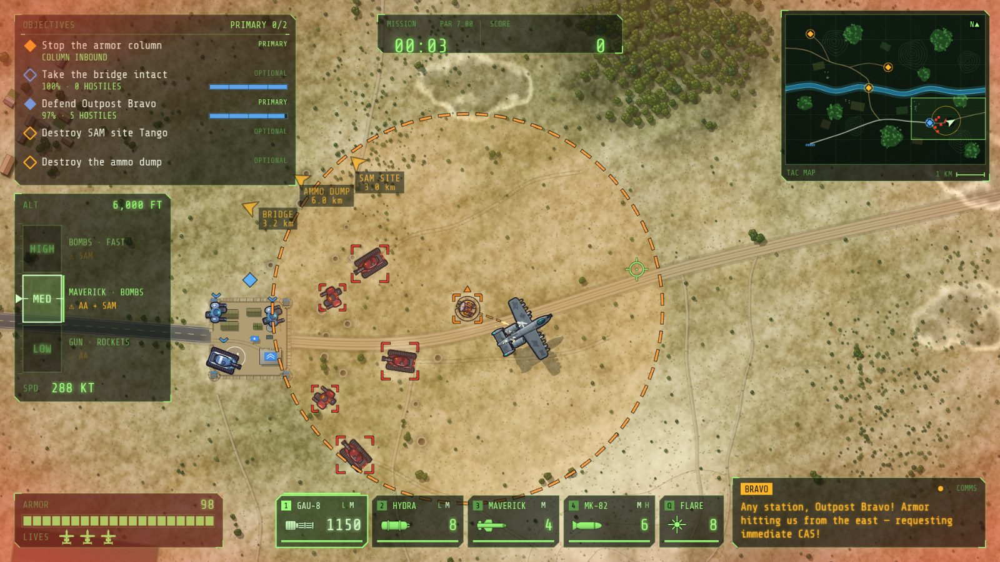

# WARTHOG

A top-down, open-map ground-attack shmup for the browser. Fly an A-10 Warthog over a living battlefield,
juggle overlapping objectives, and pick your altitude: **Low** for the deadly gun, **Medium** for
Mavericks and precise bombs, **High** for speed and a view of the whole sector.

Xevious meets Desert Strike, with a third dimension.

**Play it in your browser: https://ryan-j-smith.github.io/warthog/** (keyboard; desktop Chrome/Firefox/Edge)



## Missions

| Mission | |
|---|---|
| **River Crossing** | Hold the river. Save Bravo. Pick your fights. |
| **Iron Sleet** | Two highways, five minutes. Nothing gets through. |
| **Three Roads** | Three roads, endless armor. Pick the fight that matters. |
| **Hold the Line** *(prototype)* | Build between waves. Fly during them. Hold the base. |

**Hold the Line** is an experimental base-defence mode:
- Between waves there's no clock. Fly over a pad and press `1`–`4` to build a barracks, tank depot,
  bunker or flak battery; press `1` again to upgrade it. Fly over the airstrip to buy upgrades for the
  aircraft. Press `R` to launch the next wave.
- Every wave is previewed before it launches. After each wave you pick one of three draft cards.
- Enemies that reach the base chip away at it, and losing the base ends the run. Being shot down only
  costs a short respawn delay.

Between missions, credits buy aircraft upgrades in the **Hangar** (armor, shield, afterburner and
more), and optional challenges pay bounties. Pick **Recruit**, **Regular** or **Ace** on the mission
select screen. Progress is saved in the browser.

## Play (dev)

```bash
npm install
npm run dev          # http://localhost:5173 (or the port Vite prints)
```

Dev shortcuts: `?play=<mission>` skips straight into a mission (`river-crossing`, `iron-sleet`,
`three-roads`, `hold-the-line`), and `window.__warthog` is the `Phaser.Game`.

## Controls

| Key | Action |
|---|---|
| `A` / `D` (or ← / →) | Turn |
| `W` / `S` (or ↑ / ↓) | Climb / dive one altitude band |
| `Space` (hold) | Fire the selected weapon |
| `Shift` (hold) | Afterburner (drains the boost meter) |
| `E` / `C` (hold) | Air brake: slower, much tighter turns |
| `1` `2` `3` `4` | Gun / Rockets / Maverick / Bombs (Hold the Line, over a pad: build) |
| `Q` | Flares (decoy SAMs) |
| `R` | Hold the Line: launch the next wave |
| `Esc` / `P` | Pause |
| `M` | Mute / unmute all sound (music and volume per channel: title and pause menus) |

**Altitude cheat sheet:** anti-aircraft guns reach Low and Medium, SAMs reach Medium and High.
- AA lasers paint you, then lock and fire: turn across the beam, or boost out of it.
- A SAM inbound: put it off your wing and boost so it overshoots, dive to Low to break the lock, or pop flares.
- Bombs land exactly on the reticle.
- Your shield recharges when you stop taking hits. Hold Low over the home base to rearm and repair the hull.

## Build and share

```bash
npm run build        # type-checks, then writes a static site to dist/
npm run preview      # serve dist/ locally to check it
```

`dist/` is a self-contained static site with relative paths, so it can be hosted anywhere:

- **itch.io:** zip the *contents* of `dist/` (so `index.html` is at the zip root), create an HTML project,
  upload the zip, and tick "This file will be played in the browser". Use a 1920×1080 or 1280×720 viewport
  with fullscreen enabled.
- **GitHub Pages:** `.github/workflows/deploy.yml` runs the tests, builds, and publishes `dist/` on every push to `master`.

## Development

```bash
npm run typecheck    # tsc --noEmit (must be zero errors)
npm test             # unit tests (Vitest)
npx vitest run --config tests/playtest/vitest.config.ts   # headless bot playtests (a few minutes)
```

- `src/sim/`: pure TypeScript simulation (no Phaser). It runs at a fixed 60 Hz, is deterministic for a
  seed, and emits `SimEvent`s. Every mission plays end to end headless.
- `tests/playtest/`: bots that fly every mission through the same controls a player uses, at three skill
  levels, and report balance tables.
- `src/render/`, `src/audio/`, `src/ui/`: Phaser-side listeners that draw and play what the sim does.
- `src/meta/`: progression (credits, hangar upgrades, challenges, saves).
- `src/config/`: all tuning numbers. `src/content/levels/`: level data.
- `public/assets/`: SVG sprites, audio and fonts.

Third-party asset licenses are listed in [CREDITS.md](CREDITS.md).
